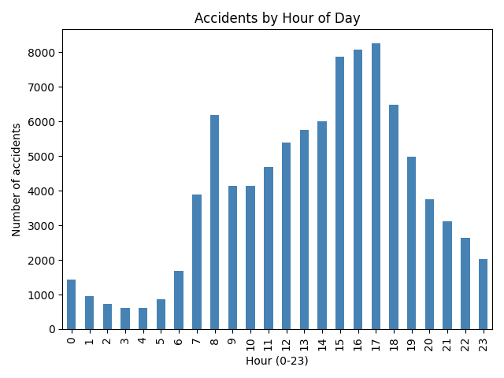
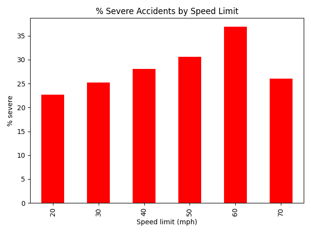
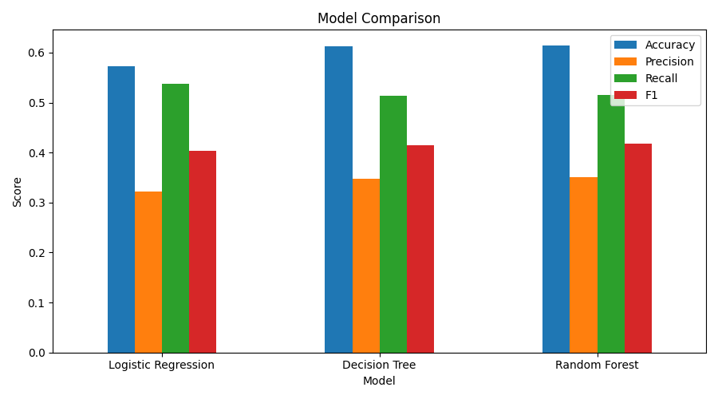

# UK Road Collision Severity Analysis and Prediction (2025)

A data science project that explores road collisions reported in Great Britain in 2025 and uses machine learning to predict whether a collision will be **severe** (fatal or serious) or **slight**.

## Dataset

- **Source:** UK Department for Transport (DfT) Road Casualty Statistics, collision file for 2025 (available from data.gov.uk, search "Road Safety Data").
- **Size:** 101,525 collisions and 44 columns.
- **Target:** `collision_severity` (1 = fatal, 2 = serious, 3 = slight) was converted into a two-class target: severe (fatal or serious) = 1, slight = 0.

## Project Workflow

1. **Load** the CSV file with pandas.
2. **Understand** the data: column names, missing values, severity counts.
3. **Select** 13 useful columns and **create features**: `hour`, `month`, `is_weekend`, `is_night`.
4. **Clean** the data: rows with `-1` (missing) and unallocated area types were removed, leaving 94,225 collisions (26.8% severe).
5. **Explore** the data with 7 charts (severity, hour, day, month, speed limit, urban vs rural, day vs night).
6. **Split** the data 80% training / 20% testing (stratified, `random_state=42`).
7. **Train** three models: Logistic Regression, Decision Tree, Random Forest (all with balanced class weights).
8. **Evaluate** with accuracy, precision, recall, F1, confusion matrix and feature importance.
9. **Save** the charts and results, and predict a new collision from custom values.

## Tools Used

- Python 3
- pandas (data loading, cleaning, feature engineering)
- Matplotlib (charts)
- scikit-learn (train/test split, scaling, models, metrics)
- Visual Studio Code (code is written as 23 runnable `# %%` blocks)

## Results

| Model | Accuracy | Precision | Recall | F1 |
|---|---|---|---|---|
| Logistic Regression | 0.573 | 0.322 | 0.537 | 0.403 |
| Decision Tree | 0.612 | 0.348 | 0.513 | 0.415 |
| Random Forest | 0.625 | 0.355 | 0.492 | 0.413 |

Precision, recall and F1 are for the severe class on the 18,845 test collisions.

### Key Findings

- Collisions peak at **5 pm** (8,245 collisions) and are fewest around 3 to 4 am.
- Friday is the busiest day and Sunday the quietest.
- The share of severe collisions rises with the speed limit, from **22.7% at 20 mph to 36.9% at 60 mph**.
- Severe collisions are more common in **rural areas (31.7%)** than urban areas (24.3%), and at **night (32.0%)** than in daytime (26.2%).
- Most important model inputs: number of vehicles, hour, month, speed limit and junction detail.
- The three models perform similarly and only moderately (about 57% to 63% accuracy). Severity depends on details not in this dataset, such as vehicle type, driver age and impact speed. These are associations in the data, not proof of cause.

### Sample Charts

If the `project_output` folder is uploaded, these images show on GitHub:





## How to Run

1. Download or clone this repository.
2. Make sure the dataset CSV is in the same folder as the Python file. If your CSV has a different name, change the filename in Block 2 of the code.
3. Install the libraries:

   ```bash
   pip install pandas matplotlib scikit-learn
   ```

4. Run the file:

   ```bash
   python road_accident_analysis.py
   ```

   Or open it in VS Code (with the Python and Jupyter extensions) and click **Run Cell** above each block.

## Output Files

All results are saved in the `project_output` folder:

- `1_severity.png` to `7_day_night.png`: exploratory charts
- `8_model_comparison.png`: comparison of the three models
- `9_confusion_matrix.png`: Random Forest confusion matrix
- `10_feature_importance.png`: feature importance
- `model_results.csv`: accuracy, precision, recall and F1 for each model
- `report.txt`: detailed Random Forest report
- `cleaned_data.csv`: dataset after cleaning

## Possible Improvements

- Add more informative features (for example vehicle type or driver age data from the related DfT files).
- Use several years of data.
- Tune the models and try methods for imbalanced classes.
